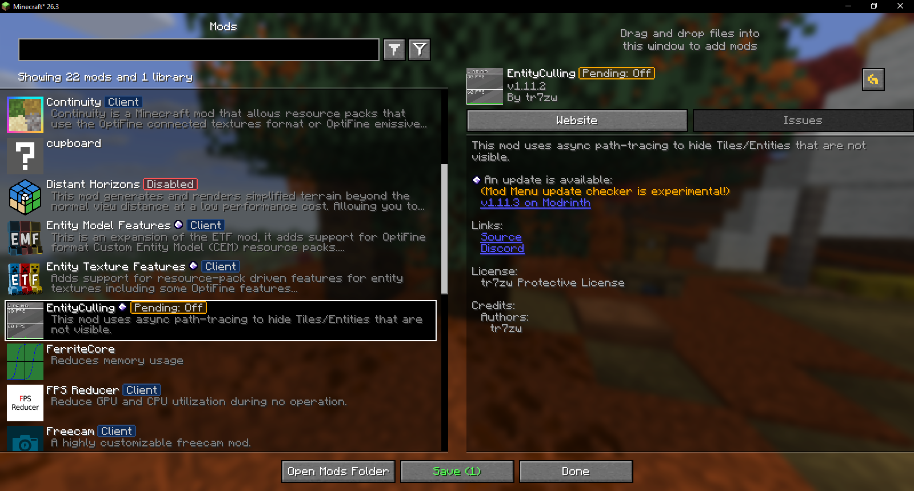

<div align="center">


# Muto

**The industrial-grade hot mod reloader for Minecraft.**

Enable, disable, load, and hot-swap Fabric mods live in-game without restarting Minecraft.

[](https://modrinth.com/mod/muto)
[](https://www.curseforge.com/minecraft/mc-mods/muto)
[](https://fabricmc.net/)
[](https://fabricmc.net/)
[](LICENSE)

[Modrinth](https://modrinth.com/mod/muto) · [CurseForge](https://www.curseforge.com/minecraft/mc-mods/muto) · [Documentation](https://muto.fy2ne.me) · [Issues](https://github.com/fy2ne/muto/issues)

</div>

---

## What is Muto?

In Minecraft's history, resource packs have `F3+T` and datapacks have `/reload`. **Mods never had an in-game reload.** Whenever you tweaked a mod, tested an update, or needed to turn off a conflicting mod, you had to close the game, wait minutes for Java and assets to restart, and repeat that dozens of times.

**Muto changes that.**

Muto provides a real-time hot-swap engine built directly into Minecraft and ModMenu:
- **Toggle mods on or off** directly in your mod list.
- **Load new mods** placed in your `mods/` directory without restarting.
- **Stage your changes** and review what's being enabled or disabled before committing.
- **Hot reload in seconds** using dynamic ClassLoader unmounting, registry thawing, and mixin retransformation.

<br />

<div align="center">



</div>

---

## Features

### Native ModMenu Integration
- **Direct Action Buttons**: Enable, disable, or load mods right from ModMenu's mod description pane with crisp, vanilla-styled monochrome pixel-art controls.
- **Mod State Badges**: Visual tags identifying mod state at a glance:
  - `Disabled` (red) — Mod jar renamed to `.jar.disabled`.
  - `Unloaded` (gold) — Mod jar detected in `mods/` but not yet loaded into runtime.
  - `Pending: Disable`, `Pending: Enable`, `Pending: Load` (green/gold) — Staged changes awaiting confirmation.
- **Smart Filter Cycle**: A dedicated filter button cycling through **All**, **Active**, **Disabled**, and **Unloaded** mods.
- **Safe Staging Workflow**: Click **Save (N)** to open a change review screen listing exact operations before applying.
- **Disabled Mod Protection**: Prevents broken config screens from opening when a mod is inactive.

### Industrial Reload Pipeline
- **Knot ClassLoader Rotation**: Dynamically unmounts and remounts mod classpaths at runtime.
- **Registry Thawing & Tombstoning**: Safely unfreezes Minecraft's `MappedRegistry` to register or prune mod entries.
- **Packet & KeyMapping Sync**: Re-registers custom network payload types and rebuilds vanilla keybind arrays.
- **Safe Boundary Manager**:
  - **Title Screen**: Instant hot reload in seconds.
  - **Singleplayer Worlds**: Safely saves world chunks, exits cleanly, applies the mod hot-swap, and reconnects the player automatically.
  - **Multiplayer Servers**: Gracefully disconnects, hot-swaps client mods, and reconnects to the server.

---

## Requirements

| Component | Target |
|---|---|
| Platform | Fabric Loader 0.16.0+ |
| Minecraft | 26.3 |
| Java Runtime | Java 25+ |
| Dependencies | Fabric API (Zero external config libraries required; ModMenu optional) |

---

## Installation

1. Install [Fabric Loader](https://fabricmc.net/use/installer/) for Minecraft 26.3.
2. Download `muto-<version>.jar` from [Modrinth](https://modrinth.com/mod/muto) or [CurseForge](https://www.curseforge.com/minecraft/mc-mods/muto).
3. Place `muto-<version>.jar` and [Fabric API](https://modrinth.com/mod/fabric-api) into your `.minecraft/mods` folder.
4. *(Recommended)* Install [ModMenu](https://modrinth.com/mod/modmenu) to access the integrated mod management UI.

---

## Developer API

Other mods, in-game downloaders (like Resourcify), and dev tools can integrate with Muto as an optional soft dependency.

### Adding Muto API

In your `build.gradle`:

```groovy
repositories {
    maven {
        name = "GitHubPackages"
        url = "https://maven.pkg.github.com/fy2ne/muto"
    }
}

dependencies {
    modCompileOnly "me.fy2ne:muto:0.2.0-beta"
}
```

In your `fabric.mod.json`:

```json
"suggests": {
  "muto": ">=0.2.0-beta"
}
```

### Checking Availability & Triggering Reloads

```java
import me.fy2ne.muto.api.MutoApi;

if (MutoApi.isAvailable()) {
    // Check if reload engine is currently running
    if (!MutoApi.isReloading()) {
        // Trigger a safe boundary reload (handles world save & auto-reconnect)
        MutoApi.triggerBoundaryReload(currentScreen);
    }
}
```

### Listening to Reload Events

Subscribe to `MutoEvents` to tear down caches or re-initialize subsystems:

```java
import me.fy2ne.muto.api.MutoEvents;

// Cleanup before reload starts
MutoEvents.RELOAD_START.register((startEpochMs, expectedDiff) -> {
    if (expectedDiff.removed().contains("my_mod_id")) {
        MySubsystem.shutdown();
    }
});

// Re-init after reload settles
MutoEvents.RELOAD_FINISH.register((endEpochMs, diff, success, durationMs, error) -> {
    if (success && diff.added().contains("my_mod_id")) {
        MySubsystem.bootstrap();
    }
});
```

---

## Building from Source

```bash
git clone https://github.com/fy2ne/muto.git
cd muto
./gradlew build          # Windows: gradlew.bat build
```

The compiled jar will be in `build/libs/`.

---

## License

Muto is open-source software licensed under the [Apache License 2.0](LICENSE).
